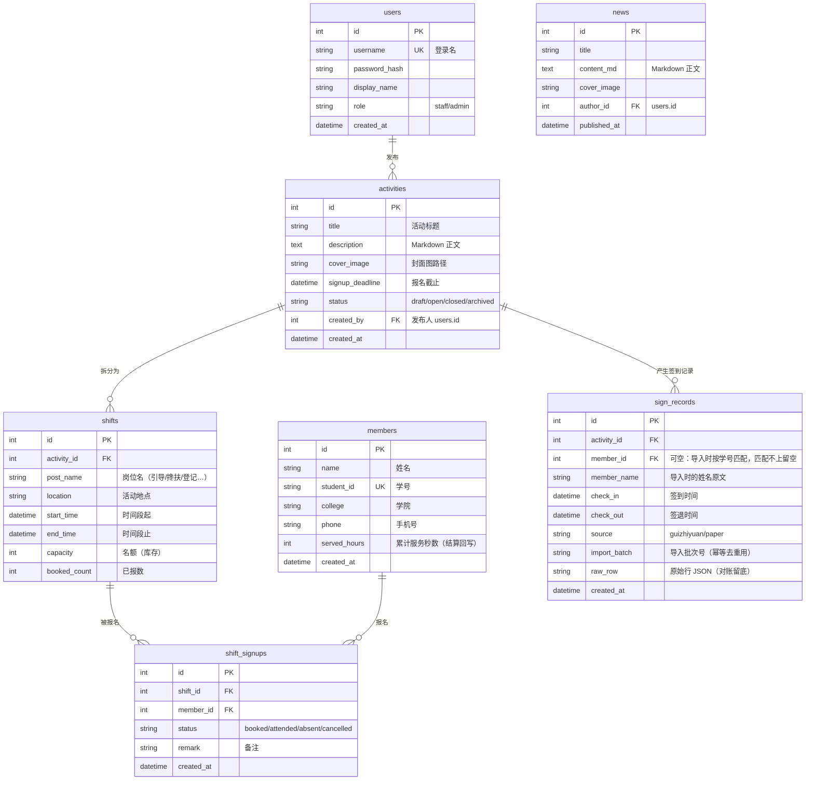

# 数据库设计

> 数据库：开发期 SQLite，上线前迁移 PostgreSQL（SQLAlchemy 屏蔽差异）。
> 主键统一自增 id；时间统一存 UTC；软删除暂不引入（M0 决策：社团数据量小，误删靠备份兜底）。

## 1. ER 图

## 2. 设计要点

1. **场次 = SKU**：`shifts.capacity` 是库存，`booked_count` 是已售。报名扣减用条件更新
   `UPDATE shifts SET booked_count = booked_count + 1 WHERE id = ? AND booked_count < capacity`
   在同一事务内完成，并发下不会超卖。取消报名对应 `booked_count - 1`（只在 status 可取消时）。
2. **防重复报名**：`shift_signups` 上唯一约束 `(shift_id, member_id)`，数据库层兜底。
3. **时段冲突校验**：应用层在同一事务内查
   `shift_signups JOIN shifts WHERE member_id = ? AND shifts.start_time < 新场次.end_time AND shifts.end_time > 新场次.start_time`
   有记录即拒绝。迁 PostgreSQL 后升级为排他约束（EXCLUDE USING gist，见需求文档 P2）。
4. **sign_records 的核对语义**：`source` 区分桂志愿导出与纸质录入；核对即两源按
   `(activity_id, member_name/student_id)` 做差集：
   - 桂志愿有、纸质无 → 疑似多签
   - 纸质有、桂志愿无 → 疑似漏扫码/忘签退
   `import_batch` 让同一份 Excel 可重复导入（幂等），`raw_row` 留原始行供对账。
5. **时长结算**：结算即 `sign_records` 按 (check_in, check_out) 计算秒数，月度报表用窗口函数
   `SUM() OVER (PARTITION BY member_id ORDER BY ...)` 累计；结果回写 `members.served_hours` 供前台展示。
6. **members 与 users 分表**：志愿者不需要登录（报名靠学号+姓名标识），users 只放有后台账号的干事/管理员。报名表单收集的姓名学号若匹配不到 members，自动为其建档（首次报名即注册）。
